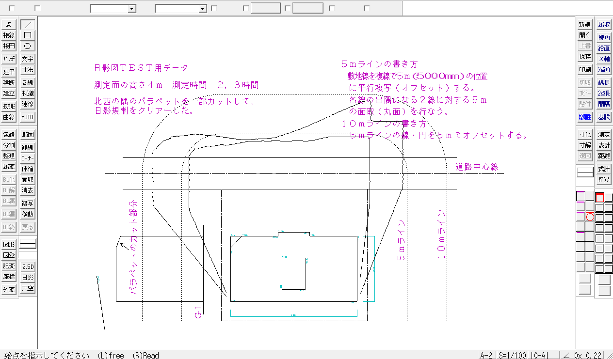
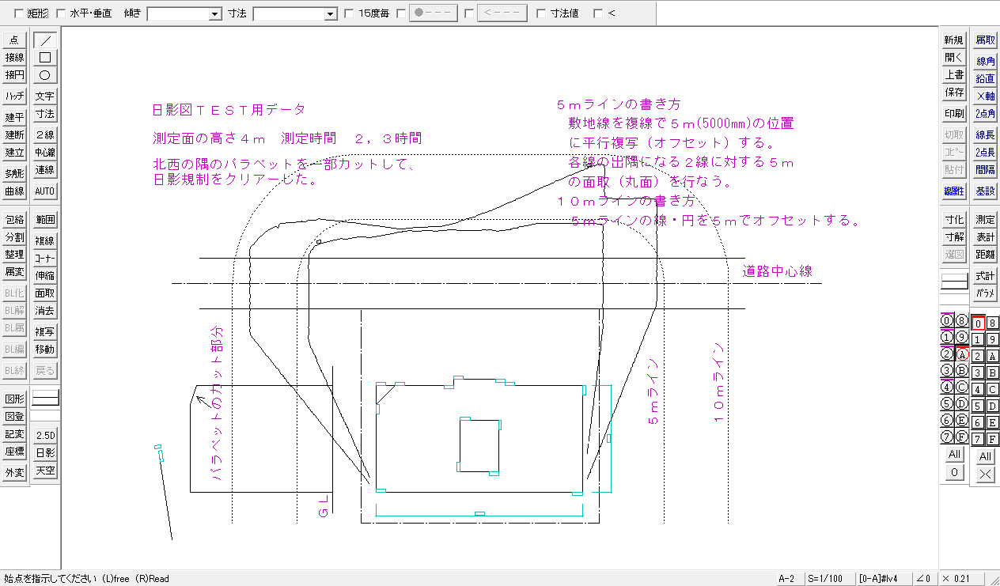

# Jw_cad for Windows — 解析と C 移植

Windows 用の 2 次元汎用 CAD **Jw_cad Version 10.03.6**（Jiro Shimizu &
Yoshifumi Tanaka、2026-09-05 版）を Ghidra で逆コンパイルして解析し、
C に書き直して WASM で動かすリポジトリです。

**動かす: <https://yomei-o.github.io/jwcad_win_wasm/>**
手元の `.jww`・`.dxf`・`.sfc`・`.jwc`・`.jws`・座標ファイルを開けて、
`.jww`・`.dxf`・`.sfc`・`.jwc` で保存できます（どこにも送られません）。
ホイールで拡大縮小、右ドラッグで移動、Home で全体。



同じ図面を原典で開いたのが下です。**違うのは字形だけ**です。



## ブラウザ版の操作

* **マウス**: 左ボタン = コマンドへの点、ホイール = 拡大縮小（ポインタ中心）、右（か中）ドラッグ = 移動、
  右クリック = (R)Read、Home = 全体
* **タッチ・ペン**: 一本指は動かすとカーソルが付いてきて、**離したところ**が点になります。二本指は
  ピンチで拡大縮小・ドラッグで移動、二本指でちょんと触れると右ボタン。画面が 800 画素より狭いとき
  （スマホ）は、図面を 800 画素幅で描いて縮めて見せます（文字は小さくなるので、拡大して使います）。
  数値の箱を押すと数字のキーボードが出ます
* **キー**: Ctrl+Z／Alt+BS 戻る、Ctrl+Y 進む、Ctrl+S 保存、Ctrl+O 開く、Ctrl+P 印刷、
  Ctrl+C／Ctrl+Insert コピー、Ctrl+X／Shift+Del 切取り、Ctrl+V／Shift+Insert 貼付、Del 消去、
  Esc 一つ戻る、Enter 範囲確定、Space 水平・垂直、a 文字・b 矩形・h 線 ほか原典の一文字コマンド
  （文字の入力中は字になります）。Ctrl+N は ブラウザが使うので 取れません
* **ファイル**: `.jww`・`.dxf` などは窓へドロップして開けます。Chromium 系（Chrome・Edge）では
  開いたファイルへそのまま上書き保存でき、「最近のファイル」が出ます。ほかのブラウザでは保存が
  ダウンロードです。どちらもどこにも送られません
* **コピー**: Ctrl+C で 図形を システムのクリップボードにも `JWCLIP:…` の字で入れます。
  ほかのタブ・窓の Ctrl+V で貼れます
* **設定**: 基本設定などは このブラウザの localStorage に覚えます（次に開いたとき戻ります）
* **文字の 範囲選択**: 文字コマンドの「範囲選択」で文字だけ選ぶと、文書（選んだ文字を .txt に書き出し）・
  外部エディタ（箱で一行ずつ直す）・貼付（クリップボードの行で置き換え）・SJIS/UTF8 の切替が使えます
* **印刷**: 「PDF で印刷」「PNG で印刷」。用紙は 図面の用紙（A-0〜A-4 など）の大きさで出ます
* **できないこと**: 外部変形（バッチファイルを走らせるため）。デスクトップ版（`jw_port.exe`）で使えます

## デスクトップ版 (`jw_port.exe`)

`tools/build_native.sh` で作ります。設定は `%APPDATA%\jw_port\` に覚え、最近のファイルは
ファイルメニューの「最新のﾌｧｲﾙ」の場所に出ます。外部変形（BAT の台本どおりに範囲・点・文字を聞いて
`JWC_TEMP.TXT` で受け渡し）と、文字の 範囲選択の 外部エディタ（NOTEPAD）が使えます。

## いまできること

**CAD として一通り使えます。**

| | |
|---|---|
| 描く | 線・矩形・円・円弧・点・連続線・文字（日本語入力つき）・ソリッド |
| 直す | 消去（部分・図形・範囲）・コーナー・線伸縮・複線・面取・分割・２線・中心線・多角形・寸法・ハッチ・曲線・包絡・データ整理・属性選択／属性変更 |
| 選ぶ | 範囲選択して複写・移動（倍率と回転角つき）・ブロック（化・解除・属性・編集・名前変更）・読取（中心点・線上点・交点・円周 1/4 点） |
| 枠 | メニュー・ツールバー・コマンドバー・レイヤ升目・ステータス行。**文字を除いて原典と 0 画素差**。窓の大きさを変えても追従します |
| 文字 | **TrueType フォントで描きます**（IPAex ゴシック／明朝、BIZ UD ゴシック。ＭＳ ゴシック・ＭＳ 明朝 などの書体名もそれに割り当て）。読み込み中・失敗時は東雲ビットマップ。書込み文字種変更の「フォント」で選べて、書体名は `.jww` にそのまま残ります |
| ダイアログ | 線属性・書込み文字種変更・基本設定（8 タブ）・軸角・寸法設定・画面倍率・用紙サイズ。どれも文字を除いて 0 画素差 |

**原典のメニューとの対応**は [`docs/command-coverage.md`](docs/command-coverage.md) に 全項目（原典の MENUITEM 194 個）あります:
動くもの 91、フロントエンド（ファイル窓・印刷など）の仕事 29、そのままでは変わらないもの 13
（範囲を選んでから・戻す物が無ければ灰色など、理由つき）、原典の右クリックメニューや内部用で バーの釦などが
同じ働きをする（か 持たない）もの 61。文書の一覧は [`docs/index.md`](docs/index.md)。

**ファイルの出し入れは 6 形式、読み書き両方あります。**

| | 読む | 書く | 突き合わせ |
|---|---|---|---|
| `.jww` | ✓ | ✓ | 原典の保存したものと 1 バイト違わず（2 万要素の往復も） |
| DXF | ✓ | ✓ | 原典の書いた DXF と 1 バイト違わず |
| SFC（SXF） | ✓ | ✓ | 同上。楕円弧・任意色・任意線種まで |
| JWC | ✓ | ✓ | 同上（頭の CSV の 5 つだけは原典のものを焼いています） |
| `.jws`（図形） | ✓ | ✓ | 図形読込／図形登録。書いたものは原典と 1 バイト違わず |
| 座標ファイル | ✓ | ✓ | 同上。文字（`cz`・`ck`・`ch`）まで |

形は [`docs/format-jww.md`](docs/format-jww.md)（`.jww`）に書き出してあります。

ネイティブの窓（`jw_port.exe`）とブラウザ（`index.html`）が**同じ
`src/*.c`** を通ります。両者が食い違えば、それは環境に依存した印です
——いまのところ**同梱の図面 16 枚とも 0 画素差**。

**続きに入る人は [RESUME.md](RESUME.md) から**読んでください。何が残って
いるかと、調べ方の記録への索引があります。

## 一致具合

```sh
sh tools/check.sh                              # 1,267 項目
sh tools/refshots.sh && sh tools/scoreall.sh   # 同梱 15 枚の採点
```

| | |
|---|---:|
| 枠（原典 対 移植、文字の外） | **0 画素** |
| 別の大きさの枠、キャプションとメニューバー | **0 画素** |
| native 対 WASM（16 枚） | **0 画素** |
| 同梱の図面 15 枚（文字の枠の外） | **524 画素**（5 枚は 0） |

残る 524 のほとんどは**部分円弧の環**で、原典はそこを GDI の `CDC::Arc`
に丸投げしています。環を描くのは `gdi32.dll` ですらなく**カーネルの
`win32kfull.sys`** なので、**読めません、測るしかありません**
（`tools/gdiarc.c` がメモリ DC に描かせて画素を数えます）。
詳しくは [`docs/notes-pixels.md`](docs/notes-pixels.md)。

**文字の枠は別勘定**です。`tests/shot.exe` が図面から字形の入る矩形を
書き出し、`tools/cmp.py` がそれを外します。**その矩形は窓の 14.3%**
（`Test6` は 35%）なので、524 は**窓の 85.7% についての数**です。

### 試験の網

| | |
|---|---|
| `sh tools/check.sh` | 1,267 項目。原典に同じ操作をさせた `.jww` と 1e-9 まで、原典の描いた画面と 1 画素ずつ |
| `tests/fuzz_test.c` | 壊れたファイル 95 万通り |
| `tests/cmdfuzz_test.c` | コマンドを手当たり次第に 204 万手 |
| `tests/bigcirc_test.c` ほか | 半径 1〜8,200・直線 12,636 本・全画素の拾い上げを端から端まで |
| `sh tools/asan.sh` | emscripten の clang で ASan/UBSan（w64devkit には `libasan` がありません）。**Windows 版では 787 万通り流しても出ない**ものが 8 つ出ました |
| `sh tools/asanseeds.sh` | 同じものを壊し方 20 通りで（数時間。`check.sh` には入れていません） |
| `sh tools/asansym.sh <名前>_test` | 一つの試験を ASan/UBSan で、報告の各フレームを関数名と行に直して出します。`JW_MOVE=1` を付けると要素の配列が**追加のたびに引っ越す**ので、`jw_add` をまたいで持ち越したポインタが即座に use-after-free になります（普段は配列が 2 倍になる瞬間にしか壊れない種類の誤り） |
| `tests/boxfuzz_test.c`・`dxfextreme_test.c`・`miscfuzz_test.c`・`imgfuzz_test.c` | 全コマンドの全部の箱に変な文字列、1e999 や nan だらけの DXF、外部変形の入力、壊れた BMP/PNG/JPEG。`JW_CMDFUZZ_EXTREME=1` の cmdfuzz は長さ 0 の線・半径 0 の円・ほぼ平行な線・1e12 すれすれの座標を図面に入れてから乱打します |
| `sh tools/ci.sh` | **入口はこれ**。数分で「ビルドできて、試験が通り、wasm が node で動き、サニタイザが黙っているか」を一覧にします（下） |

### `sh tools/ci.sh` —— 一つで通す入口

原典が要らず、数分で終わる検査を順に流して、最後に PASS / FAIL / SKIP の表を出します
（FAIL の数が終了コード）。各段の出力は `tmp/ci/<段>.log` です。

```
sh tools/ci.sh              # 全部
sh tools/ci.sh fast         # サニタイザの段 (asan) を除く
sh tools/ci.sh qtest wasm   # 名前を挙げた段だけ
```

| 段 | 中身 |
|---|---|
| `tests` | `tools/build_tests.sh`: `tests/*_test.c` を警告つきで全部ビルド |
| `qtest` | `tools/qtest.sh`: 答え合わせの試験の素早い一組＋オフラインの差分ファジング |
| `native` | `tools/build_native.sh`: `jw_port.exe`（`src/main_win32.c` もここでコンパイルされる） |
| `wasm` | `tools/build_wasm.sh` を `WASM_OUT=tmp/wasmci` で。**リポジトリ直下の配布用 `jwcad.js`・`jwcad.wasm` は触りません** |
| `smoke` | `tools/smoke_wasm.js`: その wasm を node で、開く→描く→保存→開き直す→DXF/SFC/JWC/環境設定→PDF/PNG→画像挿入→壊れた入力 |
| `fuzz` | 壊れたファイル・乱打・画像（BMP/PNG/JPEG）・外部変形の入力を、ネイティブで短く |
| `browser` | `tools/web/cdp*.js`: 本物の Chrome／Edge を DevTools で操作（ヘッドレス）。開く・描く・Ctrl+Z／Y・クリップボード・手書線・英語表示・オフライン／インストール（`sw.js`）・1.5 GB のファイル・自動保存の控え。`WASM_DIR` でどの wasm か、`CHROME` でどのブラウザか、`CDP_PORT` で 9334 以外のポートを選べます |
| `asan` | `tools/asanone.sh` で上の読み手と答えの試験いくつかを ASan と UBSan に（emscripten と node が要る） |

gcc・emcc・node が見つからない段は SKIP になります。見つけ方は他の `tools/*.sh` と同じ
（`C:\prog\w64devkit` か `C:\prog\tools\w64devkit`、`EMSDK`、emsdk 付属の node と python）。
`tools/check.sh`（原典との 1 画素ずつの突き合わせ、25 分）と `tools/asan.sh`・`asanseeds.sh`（数時間）の代わりではなく、その前の足慣らしです。

**読み手・作図・入口をいじったら `asan.sh` を回してください。**
**乱打だけでは届かないものもあります** —— 円の環の置き場が溢れるのは
半径 5,792〜8,189 という 1.4 倍の帯でだけで、39 万件×198 ファイルを
ASan に通しても報告ゼロでした。そういうものは**定義域を端から端まで歩く
試験**のほうが早いです（[`docs/notes-tests.md`](docs/notes-tests.md)）。

## 原典を用意する

`jww10036.exe`（Inno Setup 6.4.2）を**ダウンロードしたそのまま**置いて
あります。中身は一切変えていません —— Jw_cad の使用条件（`Jw_win.txt`
「（３）転載及び配布」）が「プログラムを改変しないこと」「このままの形態で
配布すること」の二つなので、配布された形のまま置くのがいちばん条件に
合います。

**そのうえで、展開した `orig/` と逆コンパイル出力 `decomp/` も入れて
あります**（2026-09-28 に所有者の判断で）。原典を持っていなくても、
`src/` の 1 行ずつが何を写したものか、答えがどう作られたかを追える
ようにするためです。**この二つは「このままの形態」ではありません** ——
その条件を満たすのは `jww10036.exe` だけです。`src/gen/`（原典のメニュー・文字列・
ツールバー・ダイアログを C の表にしたもの。3.9 MB）も**入れてあります**
（2026-10-14 の判断）: 同じ原典から作った表で、新しく渡すものは増えず、
これが無いと Python と Pillow を入れて 1 分の生成を回すまで ビルドできないからです。
作り直したいときだけ `sh tools/gen.sh -r`（下）。

## 取ってきたまま ビルドする（ブートストラップ）

**`git clone` したものを そのまま ビルド・試験するのに要るのは C コンパイラだけです**
（Windows なら w64devkit: `C:\prog\w64devkit` か `C:\prog\tools\w64devkit` に置くと
`tools/*.sh` が見つけます。Git Bash の `sh` で回します）。原典も Python も要りません。

```sh
sh tools/build_native.sh        # jw_port.exe（Windows。-lgdi32 などが要るので Windows のみ）
sh tools/qtest.sh               # 答え合わせの試験（1 分）。Python があれば 最後にファジングの差分も
sh tools/package.sh --no-wasm   # dist/ に配布物（wasm を作るには emsdk と Python が要る。--no-wasm は 直下のものを使う）
```

ブラウザ版は `index.html` と直下の `jwcad.js`・`jwcad.wasm` を 静的に配るだけです（`tools/build_wasm.sh` は
emsdk を使って 作り直します）。**clone したものだけでは出来ないこと**は 原典を起動する段（`tools/gen.sh`
の後半、`refanswers.sh`、`check.sh` の原典との突き合わせ）で、Windows と Jw_cad を入れた機械が要ります。

`src/gen/` を作り直す（`orig/` や `decomp/res/` の答えが変わったとき）:

```sh
python -m pip install pillow    # 要るのは Pillow だけ（ほかは標準ライブラリ）
sh tools/gen.sh -r              # 原典を動かさずに、コミット済みの答えから（1 分）。node があれば ツールチップの表も
```

2026-10-14 に 新しく取り出した木で `gen.sh -r` を回し、いまの `src/gen/` と**同じバイト**になることを
確かめました（44 ファイル中 43。違った `tgdat.inc` は 建具のデータを そのまま埋めるので、git の改行の
自動変換（autocrlf）で 大きさが変わります）。

## 原典を展開して 全部（生成と 原典との突き合わせまで）やり直す

```sh
./jww10036.exe /VERYSILENT /SUPPRESSMSGBOXES /NORESTART /NOICONS \
    "/DIR=<この木のある場所>\orig"
sh tools/gen.sh      # 生成物を全部（-q で原典を動かす手前まで）
sh tools/check.sh    # 全部の検査
```

`tools/gen.sh` の前半は `Jw_win.exe` を読むだけの計算で 1 分ほど、後半は
**原典を実際に起動して**コマンドバー・線属性ダイアログ・検査用の図面を
読み出すので 20 分ほど。順番に意味があります（`btnmap.py` は `rsrc.py` の
出力を、`mkcmd.py` は `btnmap.py` の出力を要ります）。中で何を呼んでいるかは
`tools/gen.sh` を直接読んでください。

**撮る側の条件はひとつだけ: 画面の拡大縮小 100%。**`Jw_win.exe` は
`<dpiAware>true</dpiAware>` を持つので、150% のまま起動すると 144dpi で
自分を描き直し、字も枠の位置も基準と別物になります。`tools/shot.ps1` は
窓を 1280×800 にするので作業領域も 800 行以上要ります。この条件さえ
合っていれば**機械が変わっても画素は同じ**でした。

原典の画面を撮るときは **`-Screen` が要ります**。Jw_cad 10.x は既定で
Direct2D に描くので `PrintWindow` では図面の部分が真っ白になります。
突き合わせの相手としては [設定]→[基本設定]→[一般(1)] で **Direct2D を
切った GDI 経路**が正解です（決定的で、アンチエイリアスに追随せずに済む）。

| ファイル | サイズ | 中身 |
|---|---:|---|
| `Jw_win.exe` | 8,537,840 | 本体。PE32 / i386、MSVC 2019（リンカ 14.29）、MFC 静的リンク |
| `common_lib*.dll` | 8.0 MB | SXF（SFC/P21）入出力 |
| `JWW2DXFConv.dll` | 383,072 | DXF 変換 |
| `JW_OPT*.DAT` | 22 本 | 建具などのパラメトリック図形。テキスト |
| `*.jww` | 14 枚 | サンプル図面 |

## 規模

| | コード | 関数 |
|---|---:|---:|
| Super Depth | 70,731 バイト | 239 |
| JW_CAD for DOS | 1,451,937 バイト | 約 1,500 |
| **Jw_cad for Windows** | **5,582,629 バイト**（`.text`） | **26,061** |

うち相当量が静的リンクされた MFC と MSVC ランタイムなので、最初の仕事は
「何をする関数か」ではなく「**どれが Jw_cad 自身のコードか**」の切り分け
です。**それは RTTI から機械的に出ます** —— 714 クラス、vtable 41,443
スロット、継承 676 本。MFC・ATL・STL を除いた Jw_cad 自身のクラスは約 240 で、
それがそのまま移植先のファイル構成になりました。
**画面まわり**（メニュー 3 本・ダイアログ 108 枚・文字列 1,598 本・
ツールバー 183 本・ビットマップ 469 枚）は `.rsrc` に文書化された形式で
入っているので、機械語から起こす必要すらありません。

クラスの木・vtable の並び・関数の棚卸し・逆コンパイルの回し方は
[`docs/notes-decomp.md`](docs/notes-decomp.md) に。

```sh
python tools/peinfo.py orig/Jw_win.exe        # セクションとインポート
python tools/rsrc.py   orig/Jw_win.exe decomp/res
python tools/rtti.py   orig/Jw_win.exe decomp/rtti
```

**5.5 MB の `.text` はラップトップで解析すると一日仕事**なので、Ghidra は
ビルドマシン（192.168.6.14、Ghidra 12.1.3 と Temurin JDK 21）で回します。
自動解析は**一度だけ**走らせてプロジェクトを残し、逆コンパイルは
`-process -noanalysis -readOnly` で開き直すので、やり直しても解析し直しに
なりません。手順は [`docs/notes-machine.md`](docs/notes-machine.md)。

## ソースの構成

| | |
|---|---|
| `src/fb.c` | 32bit のフレームバッファ。矩形塗り・3D 枠・4bpp 転送だけ |
| `src/app.c` | 両方の入口が共有する画面 |
| `src/main_win32.c` / `src/main_wasm.c` | ネイティブの窓 / ブラウザ。`SetDIBitsToDevice` と `putImageData` を 1 回呼ぶだけ |
| `src/jww.c` ほか | `.jww`・DXF・SFC・JWC・`.jws`・座標ファイルの読み書き |
| `src/view.c` | 用紙のミリを画面の画素へ |
| `src/draw.c` | 線・円弧・点・ソリッド。線種は 32 ビットのパターン |
| `src/text.c` `src/fontx.c` | 文字。字形は東雲フォント（Public Domain、`font/`） |
| `src/cmd.c` `src/pick.c` `src/houraku.c` ほか | コマンドと拾い上げ |
| `src/ui.c` | 枠を描く |
| `src/gen/` | `.rsrc` から焼いたビットマップと配置表（生成物、非コミット） |
| `tools/cmp.py` | 原典と 1 画素ずつ比べて差分画像を出す |

## 記録

| | |
|---|---|
| [RESUME.md](RESUME.md) | **いまどこまで・何が残っているか・進め方** |
| [docs/notes-pixels.md](docs/notes-pixels.md) | 画素を合わせる。円弧・線種・仮点・格子・採点 |
| [docs/notes-formats.md](docs/notes-formats.md) | ファイル形式 |
| [docs/notes-commands.md](docs/notes-commands.md) | コマンドとダイアログ |
| [docs/notes-tests.md](docs/notes-tests.md) | 試験とサニタイザ |
| [docs/notes-machine.md](docs/notes-machine.md) | 機械まわりと、原典の駆動 |
| [docs/notes-decomp.md](docs/notes-decomp.md) | 逆コンパイル出力から読めること |
| [docs/format-jww.md](docs/format-jww.md) | `.jww` の形 |
| [docs/notes-history.md](docs/notes-history.md) | 何がどの順に解けたか |

## フォント

文字の字形は **`fonts/` の TrueType**（IPAex ゴシック・IPAex 明朝：IPA Font
License v1.0、BIZ UD ゴシック：SIL OFL 1.1。いずれも CP932 の字だけに切り出した
サブセット、計約 6.6MB）を `src/stb_truetype.h`（パブリックドメイン）で描きます。
ブラウザは使う書体だけ `fonts/` から取りにいき（wasm には入れません）、届くまでと
失敗時は東雲ビットマップ（Public Domain）です。ネイティブは exe の隣の `fonts/`
から読みます。**選び方**: 文字コマンドのバーの「文字種」ボタン → 書込み文字種変更の
「フォント」の箱 → ＭＳ ゴシック／ＭＳ Ｐゴシック／ＭＳ 明朝／ＭＳ Ｐ明朝／IPAexGothic／
IPAexMincho／BIZ UDGothic → OK。以後に書く文字がその書体名を持ち、保存した `.jww`
にも書体名が入ります。出どころ・ライセンス本文は [font/PROVENANCE.md](font/PROVENANCE.md)。
原典と画素を突き合わせる試験は `jw_outfont_enable` を入れない（既定）ので従来の
ビットマップのままです。

## 著作権

Jw_cad の著作権は **Jiro Shimizu & Yoshifumi Tanaka** にあり、フリー
ソフトウェアです。使用条件の全文はインストーラを展開して `orig/Jw_win.txt`
を読んでください。`orig/`・`decomp/` とも、上の断りのうえで
このリポジトリに入れてあります。

## オフラインとインストール

ブラウザ版は 一度開くと `sw.js` が プログラムとフォントを覚え、ネットワークが無くても開けます。
Chrome・Edge では アドレスバーの「インストール」から アプリとして入れられます
（`manifest.webmanifest`）。新しい版は ネットワークがあるとき 次に開いたときに 入ります。
ツールバーの釦に カーソルを置くと 原典の説明（ステータス行の文）が ツールチップに出ます。

## 自動保存・復元・バックアップ

* **デスクトップ版**: 変更して保存していない図面は 2 分ごとに `%APPDATA%\jw_port\autosave.jww` へ控えを置きます
  （環境変数 `JW_AUTOSAVE_SEC` で秒数を変えられます）。保存するか 閉じるときに「変更を保存しますか？」へ
  答えると 控えは消えます。強制終了のあとの次の起動で「復元しますか？」と聞きます。上書き保存の前の
  ファイルは `名前.jww.bak` に残ります。窓の位置と大きさ、最近のファイル、基本設定も覚えます。
  ウィンドウへ `.jww`・`.dxf`・`.sfc`・`.jwc` をドロップして開けます。高 DPI の画面では 図面を 2 倍・3 倍にして
  くっきり見せます。印刷は プリンタ（紙の大きさに合わせて縮小）か PDF / PNG のファイルを選べます。
  `tools/smoke_native.ps1` が 起動・描画・自動保存・保存・.bak・ドロップ・閉じる確認・強制終了からの復元・
  窓位置・高 DPI を メッセージを送って確かめます。
* **ブラウザ版**: 30 秒ごと（タブを隠したときも）、変更があれば IndexedDB へ控えを置きます。次に開くと
  「保存されていない図面が残っています」の帯が出て、復元か破棄を選べます。保存すれば控えは消えます。

## 配布用にまとめる

`sh tools/package.sh` が `dist/` に 次を作ります（インストーラは作りません）。

* `dist/jw_port-win64.zip` —— `jw_port.exe`・`fonts/`・README。どこへ展開しても動きます
* `dist/web/` —— `index.html`・`jwcad.js`/`.wasm`・`sw.js`・`manifest.webmanifest`・アイコン・`fonts/`。
  パスは全部 相対なので、どの URL の下（GitHub Pages のサブパスなど）に置いても動き、オフラインにもなります
* `dist/jwcad-web.zip` —— 上と同じものを 一つに

`--no-wasm` を付けると ルートの `jwcad.js`/`.wasm` をそのまま使います。サブパスでの動作は
`PWA_DIR=dist/web PWA_PREFIX=/jw/app/ node tools/web/cdp_pwa.js` で 確かめられます。
印刷の確かめ（Microsoft Print to PDF へ 対話なしで）は `tools/print_native.ps1`、日本語名のフォルダ・
ファイルでの起動〜保存〜復元は `tools/smoke_native.ps1` です。

## 言語

ページの枠（ボタン・ヒント・メッセージ・確認の文）は 日本語と英語があります。`?lang=en` / `?lang=ja` か
ヘッダの「English / 日本語」で選び、選んだものは覚えます。原典の言葉（メニュー・バー・問いかけ・ダイアログ）は
原典のまま日本語です。デスクトップ版の確認の箱は 日本語の Windows では日本語、ほかは英語で、
`JW_LANG=en|ja` か ini の `[ui] lang=` で 選べます。

## ヘルプとコマンド検索（ブラウザ版）

**F1** か **?**（文字を打っているとき以外）でキーとマウスの一覧、**Ctrl+K** で「コマンド検索」が出ます
（画面のボタンからも）。検索は 命令の名前か 原典の説明の言葉を 打つと（スペースで 絞り込み）一覧になり、
↑↓ で選んで Enter で メニューの項目と同じように 実行します。一覧は `cmdlist.js`（`node tools/mkcmdlist.js`
が `docs/command-coverage.md` の「動く」「フロントエンド」の項目から作る）です。
